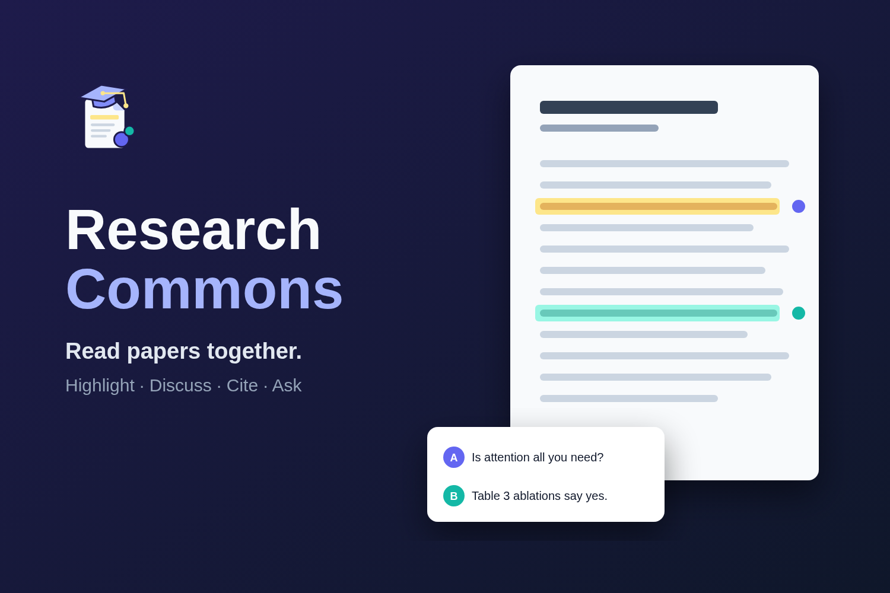
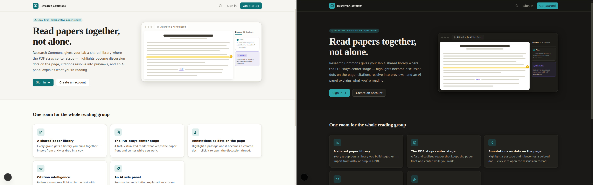
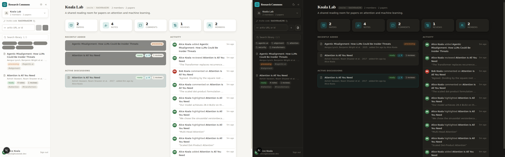
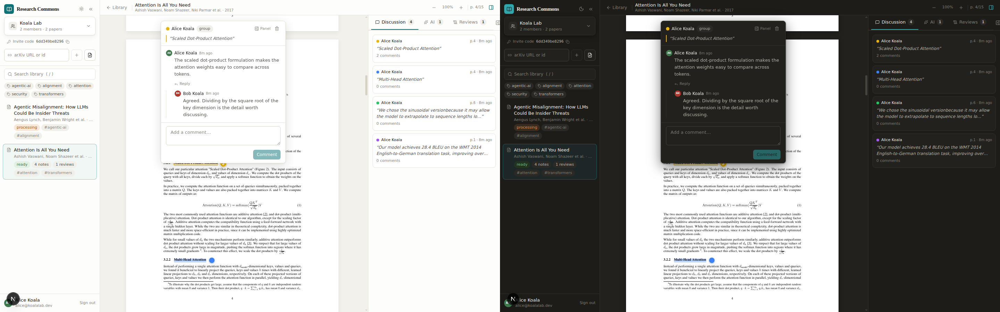
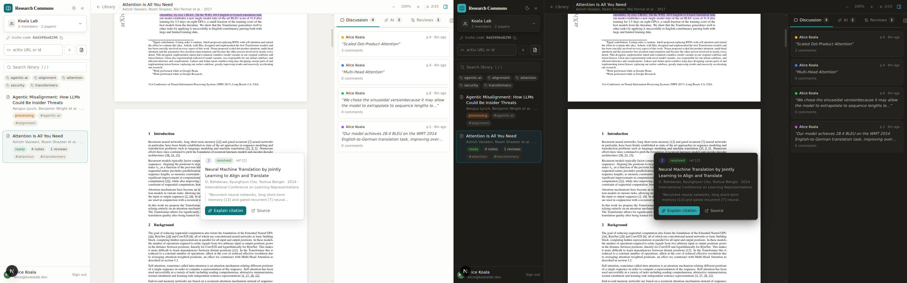
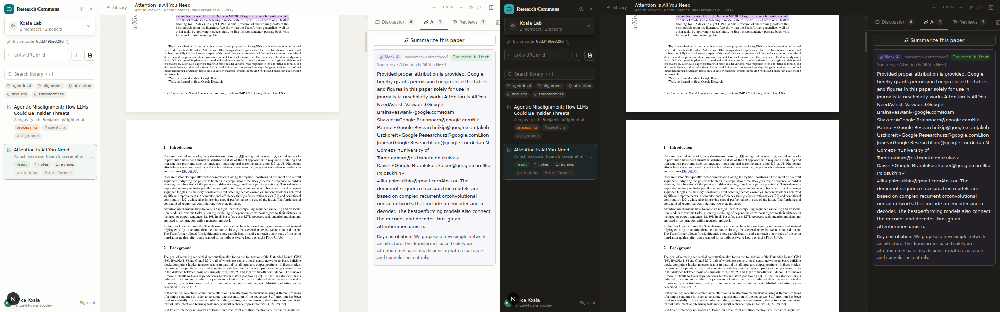
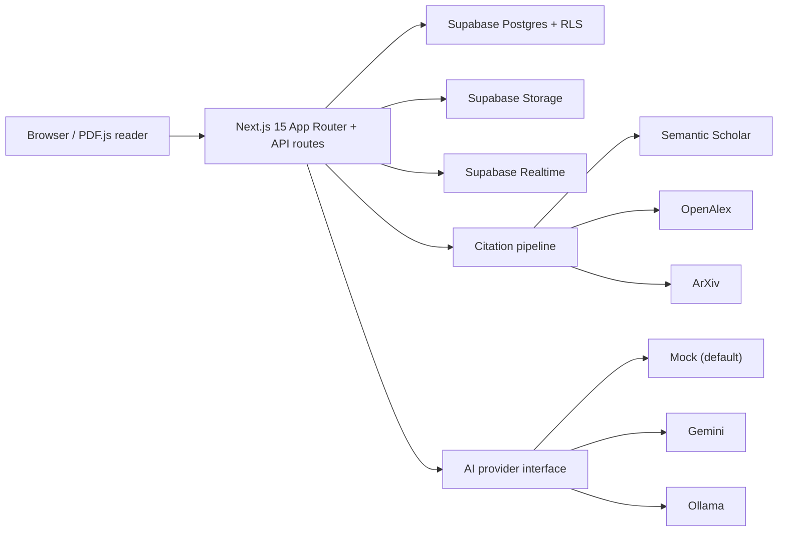

<p align="center">
  
</p>

<h1 align="center">Research Commons</h1>

<p align="center">
  A social platform for reading research: your lab reads, highlights, argues about and learns from papers together, right on the PDF.
</p>

<p align="center">
  
  
  
  
  
  
  
</p>

Built in one day at the **Devin Hackathon** at **HackerHouse, Georgia Tech**.

**[▶ Watch the 45-second demo](docs/assets/demo.mp4)** (dark mode, Alice and Bob in Koala Lab)

## Why

- Research is growing faster than our capacity to read it.
- ICLR 2027 has registered over 60,000 abstracts; ICLR 2013 had 67 submissions.
- Peer review is buckling under volume.
- Careful paper reading and literature review are fading skills.
- As agents do more of the building, thinking has to stay human.

**Who it's for:** budding researchers, undergrads and new PhD students who want to learn how experienced PhDs, postdocs and professors actually read a paper: what they highlight, what they question, which citations they chase and where they disagree. Research Commons makes that expert reading visible on the page, so the know-how gets passed on instead of staying in someone's head.

## Features

| Feature | What | Why it matters |
|---|---|---|
| **Read together on the page** | A shared PDF reader with highlights and annotations anchored to passages. | Keep the discussion attached to the evidence. |
| **Discuss & disagree** | Threaded comments anchored to the exact passage. | Make different readings visible and productive. |
| **Shared & private (RLS-enforced)** | Group annotations and author-private notes, enforced by Supabase Row Level Security. | Share ideas without exposing private drafts. |
| **Structured reviews** | Capture a group's assessment of a paper in a structured review. | Turn reading into a reusable record of strengths, limitations, and questions. |
| **Citations you can follow** | Match references to real work metadata via Semantic Scholar, OpenAlex, and arXiv when available; unresolved references stay unresolved, never fabricated. | Follow the paper's source trail instead of trusting invented citations. |
| **AI that keeps you reading** | On-demand, source-grounded summaries, citation explanations and Ask AI Q&A with page-linked evidence quotes; Mock AI by default, Gemini and Ollama pluggable. | Get help with the paper while keeping claims tied to evidence. |
| **Lab feed** | A group activity feed for papers, annotations, and reviews. | See what your lab is reading and discussing. |

## Screenshots

<!-- screenshots -->
<sub>Light on the left, dark on the right.</sub>

**Landing**



**Koala Lab dashboard**



**Reader: highlight dots + live thread**



**Citation preview: [2] → Bahdanau et al.**



**AI summary grounded in full text**




## Quickstart

**Prerequisites:** Node.js 20, pnpm 9, Docker, and the Supabase CLI.

```sh
pnpm install
supabase start
pnpm db:reset && pnpm env:local && pnpm seed:demo
pnpm dev
```

Sign in to the seeded **Koala Lab** with either demo account:

| User | Email | Password |
|---|---|---|
| Alice Koala | `alice@koalalab.dev` | `koala-demo-123` |
| Bob Koala | `bob@koalalab.dev` | `koala-demo-123` |

Koala Lab includes two papers: **Attention Is All You Need** and **Agentic Misalignment: How LLMs Could Be Insider Threats**.

Built under a hackathon timeframe, the demo runs on a deterministic mock AI provider and seeded demo data (Koala Lab, Alice and Bob). The rest is real: PDF parsing, citation resolution against Semantic Scholar/OpenAlex/arXiv, Postgres row-level security, and realtime sync. Real models are one env var away: Gemini (`AI_PROVIDER=gemini` plus `GEMINI_API_KEY`, free tier) or fully local Ollama (`AI_PROVIDER=ollama`, configurable with `OLLAMA_BASE_URL` and `OLLAMA_MODEL`) adapters are implemented behind the same interface.

## Architecture



See the [architecture](docs/architecture.md) and [API contracts](docs/api-contracts.md).

## Quality

- Gate: `pnpm lint && pnpm typecheck && pnpm check:secrets && pnpm test && pnpm build`.
- The citation pipeline is tested against five real arXiv papers. **Attention Is All You Need** has 40 parsed references, 38 resolved references, and 76/76 markers linked.
- A recorded two-user E2E exercises the shared reading flow with Alice and Bob.

## Roadmap

- Coaching to help people learn how to read a paper.
- Cross-paper research memory.
- Public reading circles and lab pages.

## Built with Devin

An orchestrator coordinated parallel frontend, backend, and ML agent tracks against shared contracts, with a review agent on every PR.
